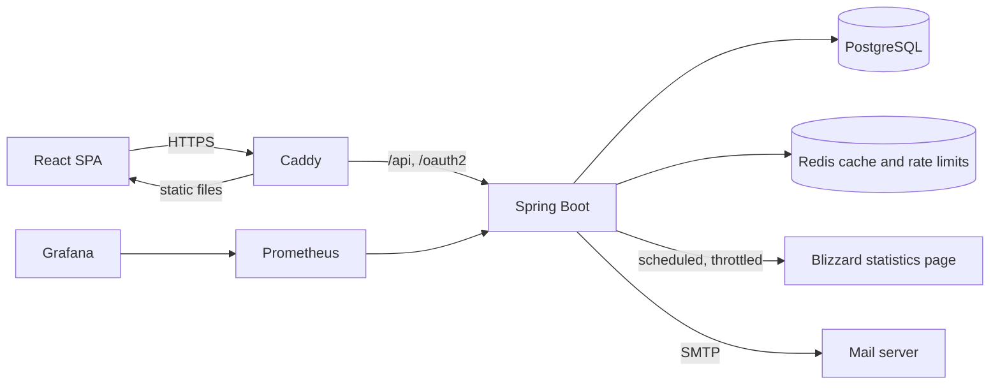

# Overlab

Unofficial fan site with Overwatch 2 hero statistics: win rate, pick rate and ban rate per hero, per map, per rank, region and platform, with history kept as snapshots. Planned extras: perks, hero descriptions, curated counter-picks and synergies, video guides. Not affiliated with Blizzard Entertainment.

## Stack

- Backend: Spring Boot (Java 21, Gradle), PostgreSQL 16, Redis 7
- Frontend: React + TypeScript (Vite)
- Monitoring: Prometheus + Grafana

## Frontend

React 19 and TypeScript with Vite. Plain CSS (dark theme by default, light theme follows the system setting), `react-router-dom`, `axios`. Code lives in `src/features/<domain>/` (`stats`, `heroes`, `maps`, `guides`, `auth`).

| Address | Page |
|---|---|
| `/stats?queue=&tier=&map=&platform=&region=&role=&sort=&direction=` | Hero statistics; filters live in the address, so every view can be shared |
| `/heroes`, `/heroes/:slug` | Heroes; a hero page has map statistics, perks, counters, synergies and guides |
| `/maps`, `/maps/:slug` | Maps; hero statistics with differences from the all-maps values |
| `/guides/:id-:slug` | Video guide (YouTube embed) |
| `/login`, `/register`, `/verify-email`, `/forgot-password`, `/reset-password` | Accounts |

Hero and map images are not shown (see `.tasks/current/0008-images-and-storage.md`).

## Architecture



The collector is the only component that talks to Blizzard. User requests are served from the database and the Redis cache.

## Structure

```
backend/    Spring Boot API and statistics collector
frontend/   React SPA
docker/     Prometheus and Grafana configuration
```

## Running locally

1. Infrastructure:

```bash
cp .env.example .env
```

Fill in `DB_PASSWORD` and `GRAFANA_ADMIN_PASSWORD` in `.env`, then:

```bash
docker compose up -d
```

2. Backend (the `local` profile is the default):

```bash
cd backend && ./gradlew bootRun
```

3. Frontend (Vite proxies `/api` and `/oauth2` to the backend on port 8080):

```bash
cd frontend && npm ci && npm run dev
```

## URLs

- Frontend: http://localhost:5173
- API: http://localhost:8080/api
- Health: http://localhost:8080/actuator/health
- Mailpit (local mail inbox): http://localhost:8025
- Prometheus: http://localhost:9090
- Grafana: http://localhost:3000

## API

The statistics endpoints are public `GET` requests.

| Endpoint | Description |
|---|---|
| `/api/heroes`, `/api/heroes/{slug}` | Heroes |
| `/api/maps`, `/api/maps/{slug}` | Maps |
| `/api/stats` | Statistics table. Parameters: `queue`, `tier`, `map`, `platform`, `region`, `role`, `sort`, `direction`. For a map it also returns deltas against the all-maps numbers |
| `/api/stats/hero/{slug}` | Statistics of one hero across all maps |

Quick Play has no ranks (`tier` is ignored) and no ban rate. Errors use one JSON shape (`ApiError`).

Curated content, also public `GET` requests:

| Endpoint | Description |
|---|---|
| `/api/heroes/{slug}/perks` | Perks with a recommendation (`RECOMMENDED`, `OPTIONAL`, `AVOID`) |
| `/api/heroes/{slug}/counters` | Heroes this hero counters and heroes that counter it |
| `/api/heroes/{slug}/synergies` | Heroes that work well together (both directions) |
| `/api/guides?hero=&map=`, `/api/guides/{id}-{slug}` | Published video guides (YouTube embeds) |
| `/api/patches`, `/api/patches/{slug}`, `/api/patches/at?date=` | Patches and the patch active at a date |

Counters, synergies and perks are curated recommendations, not statistics. They are managed through the admin API (`ADMIN` role): `/api/admin/perks`, `/api/admin/hero-relations`, `/api/admin/guides`, `/api/admin/patches`, `PUT /api/admin/heroes/{slug}` and `PUT /api/admin/maps/{slug}`. Any admin change clears the content caches.

### Authentication

Email and password registration plus Google sign-in. Tokens are stored in `httpOnly` cookies (access token 15 minutes, refresh token 14 days, rotated on every refresh).

| Endpoint | Description |
|---|---|
| `POST /api/auth/register` | Create an account and send a verification email |
| `POST /api/auth/verify-email`, `/resend-verification` | Confirm the email address |
| `POST /api/auth/login`, `/refresh`, `/logout` | Sign in, rotate tokens, sign out |
| `GET /api/auth/me` | Current user |
| `POST /api/auth/forgot-password`, `/reset-password` | Password reset by email |
| `GET /oauth2/authorization/google` | Start Google sign-in (needs `GOOGLE_CLIENT_ID` and `GOOGLE_CLIENT_SECRET`) |

Authentication endpoints are rate limited per IP (Redis). `/api/admin/**` requires the `ADMIN` role. To create the first admin, start the backend once with `ADMIN_EMAIL` and `ADMIN_PASSWORD` set. Locally, emails go to Mailpit; in `prod` set `JWT_SECRET` (at least 32 characters) and the `MAIL_*` variables.

### Audit log

Every admin change (perks, counters, synergies, guides, patches, hero and map edits) and user events (registration, sign-in, password change) are written to `audit_log` asynchronously, after the transaction commits, so a failed write never breaks the request. Updates store only the changed fields as `{from, to}`. Secrets and request bodies are never stored. Admins read it with `GET /api/admin/audit` (filters: `entityType`, `actorId`, `action`, `from`, `to`, `page`, `size`). User events are deleted after `app.audit.user-event-retention` (default 90 days).

## Statistics collector

The backend collects statistics from Blizzard's public hero statistics page on a schedule and stores a snapshot per filter combination. Jobs are defined in `backend/src/main/resources/collector.yaml`:

- `daily-overview`: all ranks for Competitive and the overview for Quick Play, all maps combined
- `weekly-maps`: every map, rank `ALL`
- `weekly-console`, `weekly-other-regions`: disabled examples (`enabled: false`) for Console and other regions

The collector retries temporary Blizzard errors, uses connect and read timeouts, and rejects a response that looks wrong (too few heroes, percentages outside 0-100, unknown roles, duplicates) instead of storing it. Every run is recorded in `collector_runs` (status `SUCCESS`, `PARTIAL` or `FAILED`, requests, failures, rows). A job never runs twice at the same time.

Admin endpoints (`ADMIN` role):

| Endpoint | Description |
|---|---|
| `GET /api/admin/collector/jobs` | Configured jobs |
| `POST /api/admin/collector/jobs/{name}/run` | Start a job now (202, 409 if it is already running) |
| `GET /api/admin/collector/runs` | Latest 50 runs |

To run one job when the backend starts:

```bash
COLLECTOR_STARTUP_JOB=daily-overview ./gradlew bootRun
```

The game format stored with every snapshot (`FIVE_VS_FIVE` or `SIX_VS_SIX`) is set with `COLLECTOR_GAME_FORMAT` and must be changed by hand when the game switches format. Snapshots older than 180 days are thinned out weekly, keeping the latest snapshot of each week. Responses are cached in Redis and the caches are cleared after every collector run.

Metrics (`collector_requests_total`, `collector_rows_saved_total`, `collector_job_duration_seconds`, `collector_last_success_timestamp_seconds`) are exposed to Prometheus, and the Grafana dashboard "Overlab: collector and API" is provisioned from `docker/grafana/dashboards/`.

## Profiles

- `local` (default): defaults for localhost, SQL logging, health details, Prometheus endpoint
- `prod` (`SPRING_PROFILES_ACTIVE=prod`): no defaults for database and Redis, no error or health details

## Deployment

The whole stack (HTTPS proxy with the React build, backend, PostgreSQL, Redis, Prometheus, Grafana, daily database backups) runs from `docker-compose.prod.yml` on a single server. See [docs/DEPLOY.md](docs/DEPLOY.md). In `prod` the metrics endpoint is served on an internal port (9091) and is not published.

## Checks

```bash
cd backend && ./gradlew build
cd frontend && npm run lint && npm run format:check && npm test && npm run build
```

`./gradlew build` runs Checkstyle (no tabs, wildcard imports or code comments) and all tests. Integration tests start their own PostgreSQL and Redis with Testcontainers, so Docker must be running, but `docker compose up` is not needed. They cover the migrations, the statistics queries, the role matrix of every protected endpoint, the sign-in flow and the audit log.

## Branches and CI

- `main`: production
- `develop`: development
- GitHub Actions runs the backend and frontend checks on every push and pull request. Dependabot opens weekly update pull requests; minor and patch updates are merged automatically after CI passes, major updates are merged manually.
