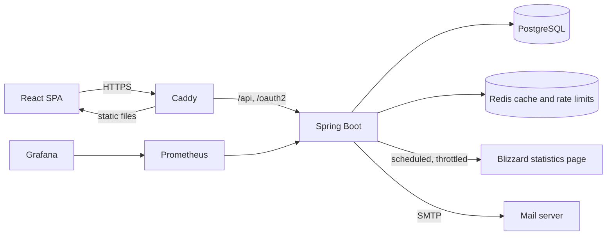

# Overlab

Unofficial fan site with hero statistics for a team shooter: **win rate, pick rate and ban rate** per hero, map, rank, region and platform, with history kept across patches. On top of the numbers it has curated content: perks, abilities, counter-picks, synergies and short video guides.

Live site: https://overlabgg.com

> Unofficial fan site, not affiliated with or endorsed by Blizzard Entertainment.

## Features

- **Statistics:** filter by queue, rank, map, region and platform; every view has a shareable address.
- **History:** snapshots are stored only when Blizzard's numbers change, so charts show real changes, with patches marked on them.
- **Changes page:** who gained or lost win and pick rate over 7 days, 30 days or a patch.
- **Hero pages:** best and weakest maps, abilities, perks, counters, synergies and guides in one place.
- **Curated content:** counters, synergies and perks are editorial recommendations managed in an admin panel, never presented as statistics.
- **Accounts:** email and Google sign-in, favorites, default filters, data export and deletion.
- **SEO and performance:** static HTML previews for crawlers, sitemap, bundle size budget, Lighthouse checks in CI.

## Tech stack

| Part | Technology |
|---|---|
| Backend | Java 21, Spring Boot, Gradle |
| Database and cache | PostgreSQL 16 (Flyway migrations), Redis 7 |
| Frontend | React 19, TypeScript, Vite, plain CSS |
| Edge | Caddy (HTTPS, static files, proxy) |
| Monitoring | Prometheus, Grafana, optional Sentry |
| Tests | JUnit, Testcontainers, ArchUnit, Vitest |

## How it works



A scheduled **collector** is the only component that talks to Blizzard's public statistics page. It pauses between requests, validates responses and stores a snapshot only when the numbers changed. User requests are served from the database and the Redis cache. It is a monolith on purpose: one backend, one frontend, one server.

## Quick start

You need Docker, and for development also JDK 21 and Node 22.22.2 or newer (`nvm use` reads `.nvmrc`).

**Whole stack in Docker:**

```bash
cp .env.example .env
docker compose up -d --build
```

Fill in `DB_PASSWORD` and `GRAFANA_ADMIN_PASSWORD` in `.env` first. The site opens at http://localhost:5173. The database starts empty: sign in as an admin and run the `daily-overview` job in the admin panel (Collector) to get the first statistics. To create the first admin, set `ADMIN_EMAIL` and `ADMIN_PASSWORD` in `.env` before the first start.

**Development with hot reload:**

```bash
docker compose up -d postgres redis mailpit prometheus grafana
cd backend && ./gradlew bootRun
cd frontend && npm ci && npm run dev
```

| Service | Address |
|---|---|
| Frontend | http://localhost:5173 |
| API | http://localhost:8080/api |
| Health | http://localhost:8080/actuator/health |
| Mailpit (local mail inbox) | http://localhost:8025 |
| Prometheus | http://localhost:9090 |
| Grafana | http://localhost:3000 |

## Project structure

```
backend/    Spring Boot API and statistics collector (package by feature)
frontend/   React SPA (src/features/<domain>)
docker/     Caddy, Prometheus and Grafana configuration
docs/       Detailed documentation
media/      Hero, map, perk and ability images (Docker volume in production)
```

## Documentation

| Document | What is inside |
|---|---|
| [Architecture](docs/ARCHITECTURE.md) | Backend conventions, layering rules, profiles, testing |
| [Frontend guide](docs/FRONTEND.md) | Folder rules, CSS conventions, pages and routes |
| [API reference](docs/API.md) | Public and admin endpoints, authentication, limits, caching, audit log |
| [Statistics collector](docs/COLLECTOR.md) | Jobs, schedule, what is stored, metrics and alerts |
| [Admin panel and media](docs/ADMIN.md) | Admin screens, images, Blizzard imports |
| [Deployment](docs/DEPLOY.md) | Server setup, updates, backups, monitoring |

## Checks

```bash
cd backend && ./gradlew build
cd frontend && npm run lint && npm run format:check && npm test && npm run build
```

Integration tests start their own PostgreSQL and Redis with Testcontainers, so Docker must be running.

## Branches and CI

- `main` is production, `develop` is development.
- GitHub Actions runs backend and frontend checks on every push and pull request. A Lighthouse workflow audits production pages after every deploy and weekly. Dependabot opens weekly update pull requests.

## License

The code is released under the [MIT License](LICENSE). Hero images and game data belong to Blizzard Entertainment and are not covered by it.

## Notes

- The Blizzard endpoint is unofficial and may change. All access to it is isolated in `collector/` behind one client class, and it is never called from user requests.
- Images of heroes are Blizzard's; downloading them is off by default (`COLLECTOR_DOWNLOAD_PORTRAITS`).
