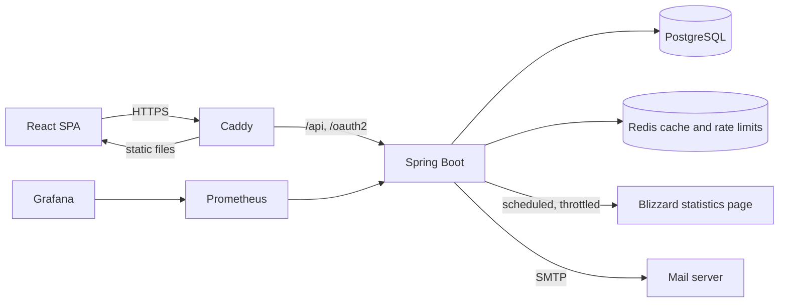

# Overlab

Unofficial fan site with Overwatch hero statistics: win rate, pick rate and ban rate per hero, per map, per rank, region and platform, with history kept as snapshots. Planned extras: perks, hero descriptions, curated counter-picks and synergies, video guides. Not affiliated with Blizzard Entertainment.

## Stack

- Backend: Spring Boot (Java 21, Gradle), PostgreSQL 16, Redis 7
- Frontend: React + TypeScript (Vite)
- Monitoring: Prometheus + Grafana

## Frontend

React 19 and TypeScript with Vite. Plain CSS (dark theme only), `react-router-dom`, `axios`. Code lives in `src/features/<domain>/` (`stats`, `heroes`, `maps`, `guides`, `auth`). Styles are split per domain: shared tokens, base styles and classes used by several domains are in `src/index.css`, the rest in `src/features/<domain>/<domain>.css` and `src/components/<group>/<group>.css`. `src/styles.css` imports them all in a fixed order (`index.css` first), because the cascade depends on that order; add a new CSS file there instead of importing it from a component. Keep a modifier rule (`.card--active`) in the same file as its base rule (`.card`) and after it, otherwise a later file can override it.

| Address | Page |
|---|---|
| `/stats?queue=&tier=&map=&platform=&region=&role=&sort=&direction=` | Hero statistics; filters live in the address, so every view can be shared |
| `/heroes`, `/heroes/:slug` | Heroes; a hero page has map statistics, perks, counters, synergies (with category chips above the hero cards) and guides |
| `/maps`, `/maps/:slug` | Maps; hero statistics with differences from the all-maps values |
| `/perks` | Perks of all heroes on one page, grouped by role, left and right as in the game |
| `/counters` | Counters and synergies of all heroes on one page, with role and name filters and a compact or detailed view |
| `/heroes/:slug/perks`, `/heroes/:slug/counters`, `/heroes/:slug/maps` | Old addresses: the edge proxy answers `301` to the matching section of the hero page (`/heroes/:slug#perks`, `#counters`, `#maps`); the hero page carries every section, so it is the single page search engines index for a hero |
| `/heroes/:slug?queue=` | A hero: rates and history, best and weakest maps (expandable to every map, each links to its map page), abilities, perks, counters, spots; `/maps/:map/:hero` redirects here |
| `/patches` | Redirects to `/changes`; patches are shown as dashed lines on the statistics chart and as views in `/changes` |
| `/changes?view=7d\|30d\|patch:<slug>&queue=` | Which heroes gained or lost win and pick rate between two snapshots |
| `/guides/:id-:slug` | A single spot or setup video (YouTube embed) |
| `/login`, `/register`, `/verify-email`, `/forgot-password`, `/reset-password` | Accounts |
| `/me` | Favorites and default filters |
| `/me/settings` | Change name, password and email, download or delete your data |
| `/feedback?from=<path>` | Form for reporting an inaccuracy, bug or typo (no login needed; opened from the footer link on every page) |
| `/business` | Sponsorship, advertising and partnership page with a contact form (no login needed; linked from the footer) |
| `/privacy`, `/terms`, `/cookies` | Legal pages linked from the footer; `/cookies` also holds the consent choices |

A cookie banner asks for consent on the first visit. Optional analytics (Umami; the `/admin` pages are never sent) and advertising stay off until allowed; the choice is stored in local storage (`overlab-cookie-consent`) and read with `useConsent`. The contact line on legal pages and the Business page comes from the `VITE_CONTACT_EMAIL` build variable (in the production compose file it is filled from `CONTACT_EMAIL`); without it they point to the Business page form.

The header has a single "Sign in" button; the sign-in and registration pages link to each other.

The header has a hero search (keyboard friendly) and a compact menu on narrow screens. Auth and admin pages are loaded lazily. `npm run size` (run in CI after `npm run build`) fails when the entry chunk exceeds 125 KB gzip or any other chunk exceeds 30 KB. Component accessibility is checked with `vitest-axe`.

### Admin

`/admin/**` is available to the `ADMIN` role only (the link appears in the header for admins). Anonymous visitors are sent to `/login` and returned afterwards, regular users get the same "Page not found" page as for an unknown address, so the admin area is not revealed. The server checks every request; the frontend only hides what is not allowed. Admin pages are marked `noindex` and disallowed in `robots.txt`.

| Address | Purpose |
|---|---|
| `/admin/heroes` | Edit hero description, hide or show a hero |
| `/admin/abilities` | Abilities per hero: choose the control slot (primary or secondary fire, ability 1 or 2, ultimate, passive); saved at once and written to the audit log |
| `/admin/perks` | Perks per hero: slot (minor or major), position (left or right, as in the game; one perk per slot and position), recommendation, note, icon upload |
| `/admin/relations` | Counters and synergies; duplicates and reverse relations are flagged before saving |
| `/admin/feedback` | Messages from visitors, including Business messages with the sender's email (resolve, dismiss, reopen) and the votes users gave to counters and synergies, most disagreed first |
| `/admin/categories` | Hero categories (name, slug, member heroes) and matchups of a hero against a category (strong, weak or works well with, note) |
| `/admin/guides` | Spots and setups: paste a YouTube link (`youtu.be/...`, `watch?v=...`), hero, map, type (setup, position, ultimate spot, tip), side (attack, defense, both), optional ability, start and end time as `1:23`, video preview, publish and order. Shown on the map page grouped by hero and on the hero page grouped by map |
| `/admin/patches`, `/admin/maps` | Patch notes; map mode and image upload |
| `/admin/collector` | Jobs, "Run now" (the run history refreshes while a run is in progress) |
| `/admin/users` | Search users, block and unblock, grant or remove admin rights |
| `/admin/audit` | Audit log with filters and "was → became" changes |

Create and edit forms open in a side panel over the table (Esc, the close button or a click outside closes it; unsaved changes ask for confirmation). Forms warn about unsaved changes when you leave the page.

The edge proxy answers `200` for the known application routes and `404` (with the same app shell, which shows the not-found page) for any other path, so crawlers do not index made-up URLs; the routes are listed in `docker/caddy/Caddyfile` and must be extended when a new top-level page is added.

### Images

Images are files in the media directory (`MEDIA_DIRECTORY`, default `./media`, `/app/media` in Docker where it is the `media` volume), split into `heroes/`, `maps/`, `perks/` and `abilities/`. The database stores only the relative path (`maps/busan-3fa9c21e.png`); the API turns it into a URL with `MEDIA_BASE_URL` (default `/media`), so the files can later move to a CDN by changing that one value. The backend serves `/media/**` with a 7 day cache; Caddy proxies it.

- **Role icons:** with the same flag the collector saves the three role icons (SVG, checked for scripts and handlers) as `roles/tank.svg`, `roles/damage.svg` and `roles/support.svg`; the site uses them next to hero names and falls back to its own simple icons when the files are missing.
- **Perk import:** with `COLLECTOR_IMPORT_PERKS=true` the button "Import from Blizzard" on `/admin/perks` reads the perk section of every hero page (`/en-us/heroes/<slug>/`, about 3 minutes with the collector pause) and creates the missing perks with their description, slot, left or right position and icon. New perks start as `OPTIONAL`; recommendations, notes and positions stay yours. A perk created by the import (`perks.imported`) follows Blizzard: when the description or slot changes in the game the site updates, unless an editor rewrote the description by hand (the import then only remembers Blizzard's text in `imported_description`), and a perk Blizzard no longer lists is deleted together with its icon. Perks you added by hand are never changed or deleted, apart from filling a missing description. A hero page that yields no perks changes nothing. The page is HTML, so the parser (`HeroPerkParser`) may need an update when Blizzard changes the markup. Off by default for the same licence reason as portraits.
- **Patch import:** every day at 03:45, before the first collector job, and once on every backend start so a missed run is caught up (`collector.patch-import.cron`, disable with `collector.patch-import.enabled=false`) the collector reads the official patch notes page (`/en-us/news/patch-notes/`) and saves each patch that changes heroes or maps: version is the release date (`2026-10-13`), title is the season or the first section name, notes hold the link to the official notes. Bug-fix-only patches are skipped, existing patches are never changed, and the notes text is not copied. The button "Import from Blizzard" on `/admin/patches` runs it now. Patches show up on the statistics chart as dashed lines. The parser (`PatchNotesParser`) fails loudly when the page markup changes. A new patch released within the last 7 days (`collector.patch-import.recent-days`) also starts a full collection in the background: every collector job with `run-on-patch: true` (the default) runs one after another with trigger `PATCH`, including jobs whose schedule is disabled (console, other regions), so heroes, maps and every configured platform and region get fresh numbers for the new patch. Set `run-on-patch: false` on a job to keep it out of that run; patches imported on a fresh install that are older than the window start nothing. When `COLLECTOR_IMPORT_PERKS=true`, the perk and ability import also runs after those jobs, so a new season's perks and reworked abilities arrive without a click.
- **Abilities:** the same import also reads the ability section of every hero page and fills `hero_abilities` (slug, name, description, icon); existing abilities get their name, description and order refreshed and a missing icon filled, and abilities Blizzard no longer lists for a hero are deleted (a renamed ability therefore replaces the old one instead of duplicating it). Text fields (counter and synergy notes, strengths, weaknesses, hero description) can mention an ability as `[[hero-slug/ability-slug]]` (for example `[[dva/defense-matrix]]`); the site shows it as a chip with the icon and a tooltip with the description, and falls back to a plain readable name when the ability is unknown. Blizzard's page does not say which button an ability uses, so `hero_abilities.control_key` (`PRIMARY_FIRE`, `SECONDARY_FIRE`, `ABILITY_1`, `ABILITY_2`, `ULTIMATE`, `JUMP`, `CROUCH`, `PASSIVE`; default PC keys LMB, RMB, Shift, E, Q, Space, Ctrl; the hero page switch also shows the Xbox, PlayStation and Nintendo Switch defaults) is curated by hand, is never touched by the import, and stays empty when unknown.
- **Maps and perks:** upload in the admin panel (PNG, JPEG or WebP, up to 2 MB; SVG is refused). The file name contains a short hash, so a replaced image is never served stale, and the old file is deleted.
- **Hero portraits:** the collector can download the portraits from the statistics response (256x256 PNG) into `heroes/`. This is off by default (`COLLECTOR_DOWNLOAD_PORTRAITS=false`) because the images are Blizzard's and the licence question is still open (see `.tasks/current/0008-images-and-storage.md`). Without it the site shows the first letter of the hero name.
- **WebP portraits:** when `cwebp` is installed (it is in the backend image, package `libwebp-tools`), new portraits are stored as `heroes/<slug>.webp` (quality 85, about 90% smaller than the PNG, visually the same), and on every backend start the portraits that are still PNG are converted once and the old files are deleted; without `cwebp` (for example a plain local run) the PNG is kept. The command can be changed with `app.media.webp-command`.
- The daily backup also archives the media volume (`overlab-media-<timestamp>.tar.gz`).

## Architecture



The collector is the only component that talks to Blizzard. User requests are served from the database and the Redis cache.

## Structure

```
backend/    Spring Boot API and statistics collector
frontend/   React SPA
docker/     Prometheus and Grafana configuration
```

## Running locally

1. Infrastructure:

```bash
cp .env.example .env
```

Fill in `DB_PASSWORD` and `GRAFANA_ADMIN_PASSWORD` in `.env`. `SENTRY_DSN` and `SENTRY_DSN_FRONTEND` are optional: when empty, error tracking (Sentry) is off. Then:

```bash
docker compose up -d --build
```

This starts the whole stack in one go: site on http://localhost:5173 (React build served by Caddy, `/api` proxied to the backend), backend, PostgreSQL, Redis, Mailpit (http://localhost:8025), Prometheus (http://localhost:9090) and Grafana (http://localhost:3000). The collector runs only on its schedule, so on a fresh database start the first collection from the admin panel (Collector, "Run" next to `daily-overview`). For hot-reload development start only the infrastructure with `docker compose up -d postgres redis mailpit prometheus grafana` and continue with the steps below.

2. Backend (the `local` profile is the default):

```bash
cd backend && ./gradlew bootRun
```

3. Frontend (Vite proxies `/api` and `/oauth2` to the backend on port 8080). It needs Node 22.22.2 or newer (`nvm use` reads `.nvmrc`; older 22.x versions fail on `jsdom` 30):

```bash
cd frontend && npm ci && npm run dev
```

## URLs

- Frontend: http://localhost:5173
- API: http://localhost:8080/api
- Health: http://localhost:8080/actuator/health
- Mailpit (local mail inbox): http://localhost:8025
- Prometheus: http://localhost:9090
- Grafana: http://localhost:3000

## API

The statistics endpoints are public `GET` requests.

| Endpoint | Description |
|---|---|
| `/api/heroes`, `/api/heroes/{slug}` | Heroes |
| `/api/maps`, `/api/maps/{slug}` | Maps |
| `/api/stats` | Statistics table. Parameters: `queue`, `tier`, `map`, `platform`, `region`, `role`, `sort`, `direction`. For a map it also returns deltas against the all-maps numbers |
| `/api/stats/hero/{slug}` | Statistics of one hero across all maps |
| `/api/stats/hero/{slug}/history` | Snapshots of one hero over time. Parameters: `queue`, `tier`, `map`, `platform`, `region`, `from`, `to` (ISO date-time; default is the last 90 days, at most 366 days) |
| `/api/stats/freshness` | When Blizzard's numbers last changed, found by comparing the latest snapshots of one queue, rank, platform and region (`valuesSince` is the first snapshot that already had the current numbers). Parameters: `queue`, `tier`, `platform`, `region` |
| `/api/stats/coverage` | Which platform, region and queue combinations have ranks and maps collected |
| `/api/stats/history-start` | When statistics collection started for one queue, rank, platform and region (`firstCapturedAt`, empty when nothing is stored); the changes page uses it to hide patches that cannot be compared. Parameters: `queue`, `tier`, `platform`, `region` |
| `/api/stats/compare` | Changes between two snapshots, biggest win rate gain first. Use `from` and `to` (the last snapshot at or before each moment) or `patch={slug}` (last snapshot before the release against one a week later) |

Quick Play has no ranks (`tier` is ignored) and no ban rate. Errors use one JSON shape (`ApiError`).

Curated content, also public `GET` requests:

| Endpoint | Description |
|---|---|
| `/api/perks` | Perks of all heroes |
| `/api/heroes/{slug}/perks` | Perks with a recommendation (`RECOMMENDED`, `OPTIONAL`, `AVOID`) |
| `/api/abilities` | Abilities of all heroes |
| `/api/heroes/{slug}/abilities` | Abilities of a hero with description and icon |
| `/api/hero-categories` | Hero categories (for example beam or dive) with their members, and curated hero-versus-category matchups (strong against, struggles against or works well with a category); shown as chips on `/counters`, where heroes covered by a chip are not repeated as separate avatars |
| `/api/hero-relations` | Counters, counters against and synergies of all heroes in one response |
| `/api/heroes/{slug}/counters` | Heroes this hero counters and heroes that counter it |
| `/api/heroes/{slug}/synergies` | Heroes that work well together (both directions) |
| `/api/guides?hero=&map=`, `/api/guides/{id}-{slug}` | Published spots and setups (YouTube embeds; `kind`, `side`, `abilitySlug`, `startSeconds`, `endSeconds`) |
| `/api/patches`, `/api/patches/{slug}`, `/api/patches/at?date=` | Patches and the patch active at a date. `season` is read from a "Season N" in the title and carried over to the later patches until the next season is announced (empty before the first one); to correct it, edit the title of the patch that opens the season |
| `/api/sitemap.xml` | Sitemap of the public pages (static pages, active heroes, maps, published guides); served as `/sitemap.xml` by the edge proxy, which also answers `/robots.txt` with the sitemap link |
| `/api/seo/preview?path=` | Small static HTML with the page title, description, canonical, Open Graph, Twitter card and `schema.org` data. The edge proxy sends link-preview crawlers (Telegram, Discord, Slack, Facebook, X, WhatsApp, LinkedIn and similar) to it for public pages; people and search engines get the normal app, which sets the same metadata itself |

Counters, synergies and perks are curated recommendations, not statistics. They are managed through the admin API (`ADMIN` role): `/api/admin/perks`, `/api/admin/hero-relations`, `/api/admin/hero-categories`, `/api/admin/hero-category-relations`, `/api/admin/guides`, `/api/admin/patches`, `PUT /api/admin/heroes/{slug}` and `PUT /api/admin/maps/{slug}` (image upload: `PUT /api/admin/maps/{slug}/image`, `PUT /api/admin/perks/{id}/icon`). Any admin change clears the content caches.

### Limits and caching

Public `GET /api/**` requests are limited per client IP in Redis: 600 per minute in general and 1200 per minute for `/api/stats/**` (a hero page makes about nine API calls, and a search engine crawler renders many pages from a few addresses, so lower limits would give it empty pages) (`app.rate-limit.api-per-minute`, `app.rate-limit.stats-per-minute`); the limit is exceeded with `429` in the `ApiError` format. Sign-in and registration endpoints keep their own stricter limit. Public responses carry `Cache-Control: public, max-age=60, stale-while-revalidate=300` and an `ETag`; errors, `/api/auth/**` and `/api/admin/**` are never cached. In `prod` the client IP is read from `X-Forwarded-For` set by Caddy.

The `content` cache is cleared on every backend start, so a release that changes cached response shapes never reads stale entries.

### OpenAPI

Swagger UI is at `/swagger-ui.html` and the OpenAPI document at `/v3/api-docs`; both require an administrator session (sign in through the site first). They are disabled in the `prod` profile. Controllers carry `@Tag` and `@Operation`, and the statistics DTOs carry `@Schema` descriptions (units, meaning of deltas); keep them in sync when changing those endpoints.

### Authentication

Email and password registration plus Google sign-in. Tokens are stored in `httpOnly` cookies (access token 15 minutes, refresh token 14 days, rotated on every refresh).

| Endpoint | Description |
|---|---|
| `POST /api/auth/register` | Create an account and send a verification email |
| `POST /api/auth/verify-email`, `/resend-verification` | Confirm the email address |
| `POST /api/auth/login`, `/refresh`, `/logout` | Sign in, rotate tokens, sign out |
| `GET /api/auth/me` | Current user |
| `POST /api/auth/forgot-password`, `/reset-password` | Password reset by email |
| `GET /oauth2/authorization/google` | Start Google sign-in (needs `GOOGLE_CLIENT_ID` and `GOOGLE_CLIENT_SECRET`) |
| `PUT /api/me/profile` | Change the display name |
| `POST /api/me/password` | Change the password (local accounts; needs the current password) |
| `POST /api/me/email` | Request an email change; the address changes after the confirmation link sent to the new one is opened (`/verify-email`) |
| `GET /api/me/export` | Download the account data (profile, favorites, votes on counters and synergies, feedback messages, default filters) as JSON |
| `DELETE /api/me` | Delete the account (local accounts confirm with the password); audit entries about the user are anonymized, the last administrator cannot be deleted |
| `GET /api/me/favorites`, `PUT`/`DELETE /api/me/favorites/heroes/{slug}`, `/maps/{slug}` | Favorite heroes and maps (200 of each at most) |
| `GET`/`PUT`/`DELETE /api/me/relation-votes` | Agree or disagree with a counter or synergy (`heroSlug`, `relatedHeroSlug`, `type`, `value` `UP`/`DOWN`; the pair works in either direction, one vote per user, 1000 at most) |
| `POST /api/business` | Send a sponsorship or partnership message (`name`, `email`, `message` of 10 to 2000 characters); login is optional, rate limited per IP. The message is stored as feedback of type `BUSINESS` and emailed to `CONTACT_EMAIL` with the sender as reply-to |
| `POST /api/feedback` | Send a message about an inaccuracy, bug or typo (`type` `INACCURACY`/`BUG`/`TYPO`/`OTHER`, 10 to 2000 characters, optional site `pagePath`); login is optional, rate limited per IP, a signed in user can have 20 unreviewed messages at most |
| `GET`/`PUT /api/me/preferences` | Default mode, rank, platform and region for the statistics filters |
| `GET /api/admin/feedback?status=NEW`, `PUT /api/admin/feedback/{id}/status`, `GET /api/admin/relation-votes/summary` | Admin: review messages (`NEW`, `RESOLVED`, `DISMISSED`) and see votes per recommendation. Votes are never shown publicly and never change the curated data on their own |
| `GET /api/admin/users`, `PUT /api/admin/users/{id}/enabled`, `PUT /api/admin/users/{id}/role` | Admin: search users, block or unblock (blocked users are signed out and cannot sign in), change role between `USER` and `ADMIN` (removing admin signs the user out; an admin cannot block or change their own account) |

Signing in with Google using an email that already has a password account links the two, so both ways work. If that account's email was not verified yet, its password is removed (use "Forgot your password?" to set a new one).

Password reset for a Google-only account sends an email that explains it signs in with Google instead of staying silent.

Authentication endpoints are rate limited per IP (Redis). `/api/admin/**` requires the `ADMIN` role. To create the first admin, start the backend once with `ADMIN_EMAIL` and `ADMIN_PASSWORD` set. Locally, emails go to Mailpit unless `.env` sets `MAIL_HOST` (and `MAIL_PORT`, `MAIL_USERNAME`, `MAIL_PASSWORD`, `MAIL_SMTP_AUTH=true`, `MAIL_STARTTLS=true`, `EMAIL_FROM`), for example with Brevo: `MAIL_HOST=smtp-relay.brevo.com`, `MAIL_PORT=587`, the SMTP login and key from Brevo, and `EMAIL_FROM` set to a sender verified in Brevo; in `prod` set `JWT_SECRET` (at least 32 characters) and the `MAIL_*` variables. Emails are sent in the background as plain text plus HTML, retried 3 times and never block the request, so a missing mail server does not break registration or password reset (the failure is only logged). `CONTACT_EMAIL` is the address that receives Business page messages; while it is empty the messages are only stored and shown in the admin panel.

### Audit log

Every admin change (perks, counters, synergies, guides, patches, hero and map edits) and user events (registration, sign-in, password change) are written to `audit_log` asynchronously, after the transaction commits, so a failed write never breaks the request. Updates store only the changed fields as `{from, to}`. Secrets and request bodies are never stored. Admins read it with `GET /api/admin/audit` (filters: `entityType`, `actorId`, `action`, `from`, `to`, `page`, `size`). User events are deleted after `app.audit.user-event-retention` (default 90 days).

## Statistics collector

The backend collects statistics from Blizzard's public hero statistics page on a schedule and stores a snapshot per filter combination. Jobs are defined in `backend/src/main/resources/collector.yaml`:

- `daily-overview`: all ranks for Competitive and the overview for Quick Play, all maps combined
- `daily-maps`: every map, rank `ALL`, both queues (about 62 requests). It has no schedule: it starts right after `daily-overview` and only when that job saved new rows, and at most once per 2 days (`min-interval: 2d`)
- `weekly-maps`: every map, every rank from Bronze to Grandmaster for Competitive (about 248 requests, roughly 12 minutes with the 3 s pause). Same rule: runs after `daily-overview` found changes, at most once per 7 days
- A job with `after: <job name>` instead of `cron` is chained. It starts when the job it follows saved rows, skips itself if its last successful run is younger than `min-interval`, and is shown in the admin panel as "After ... finds changes". Runs started by a patch are not chained, because a patch already runs every job
- `daily-other-regions`: PC in Americas and Asia, both queues, rank `ALL`, all maps combined
- `other-regions-ranks`: PC in Americas and Asia, Competitive, every rank from Bronze to Grandmaster (16 requests), all maps combined. Chained after `daily-other-regions`
- `americas-maps`: PC in Americas, every map, rank `ALL`, both queues (62 requests), at most once per 2 days. Chained after `daily-other-regions`
- `asia-maps`: the same for PC in Asia, at most once per 7 days, because the sample is smaller and the numbers change slower
- `americas-rank-maps`: PC in Americas, every map and every rank for Competitive (248 requests, about 12 minutes), at most once per 7 days. Not started by a patch (`run-on-patch: false`)
- `daily-console`: Console in every region, both queues, rank `ALL`, all maps combined
- `console-ranks`: Console in Europe and Americas, Competitive, every rank, all maps combined. Chained after `daily-console`
- `console-asia-ranks`: the same for Console in Asia, at most once per 7 days
- Maps and rank by map for Console, and rank by map for Asia, are not collected: the samples are too small for those slices to be reliable

`GET /api/stats/coverage` lists which platform, region and queue combinations have ranks (`tiers`, all maps combined) and which have maps (`mapTiers`), read from `snapshot_checks` and cached with the other statistics. The statistics, map, hero and changes pages use it to enable only the rank and map filters that have data, so a job in `collector.yaml` needs no matching frontend change. While the request is loading or failing the pages fall back to the old rule: ranks and maps only for PC in Europe.

The region shown by default is chosen in this order: the region saved in the browser after the visitor picked one (`localStorage` key `overlab.region`), the default region from the profile, the region of the browser time zone (`frontend/src/features/stats/region.ts`: the Americas, including Oceania, for `America/*` and `Australia/*`; Asia for `Asia/*` except the Middle East, the Caucasus and Russia; Europe for the rest), then Europe. The header has a region switch that works on every page, and for a signed-in visitor it also saves the choice as the default region of the profile. The hero page and the hero history chart follow it; the statistics, map and changes pages read it when the address has no `region` parameter. An address without `region` therefore means "the visitor's own region".

The collector retries temporary Blizzard errors, uses connect and read timeouts, and rejects a response that looks wrong (too few heroes, percentages outside 0-100, unknown roles, duplicates) instead of storing it. Every run is recorded in `collector_runs` (status `SUCCESS`, `PARTIAL` or `FAILED`, requests, failures, rows). A job never runs twice at the same time.

Admin endpoints (`ADMIN` role):

| Endpoint | Description |
|---|---|
| `GET /api/admin/collector/jobs` | Configured jobs |
| `POST /api/admin/collector/jobs/{name}/run` | Start a job now (202, 409 if it is already running) |
| `GET /api/admin/collector/runs` | Latest 50 runs |
| `POST /api/admin/collector/perks/import` | Import perks from the Blizzard hero pages in the background (202; 400 while `COLLECTOR_IMPORT_PERKS` is off, 409 if already running) |
| `POST /api/admin/collector/patches/import` | Import new balance patches from the Blizzard patch notes page now, returns `{created}` |

To run one job when the backend starts:

```bash
COLLECTOR_STARTUP_JOB=daily-overview ./gradlew bootRun
```

The game format stored with every snapshot (`FIVE_VS_FIVE` or `SIX_VS_SIX`) is set with `COLLECTOR_GAME_FORMAT` and must be changed by hand when the game switches format. Snapshots older than 180 days are thinned out weekly, keeping the latest snapshot of each week. Responses are cached in Redis and the caches are cleared after every collector run.

**What is stored.** One row per hero for every combination of mode (Quick Play or Competitive), platform, region, rank and map, with win rate, pick rate and ban rate (Competitive only), the capture time, the game format (`COLLECTOR_GAME_FORMAT`) and the source. A snapshot is stored only when the numbers differ from the previous snapshot of the same combination (a hash of every hero's win, pick and ban rate is compared); an unchanged run only moves the combination's `last_checked_at` in the `snapshot_checks` table, which is also where the last Blizzard `ETag` is kept. The next request sends it as `If-None-Match`, and a `304` answer skips parsing and storage altogether. Pages show the check time ("Checked 5 hours ago") and, from `GET /api/stats/freshness`, when Blizzard last changed the numbers; history charts are extended to the last check. Snapshots are kept as they were captured; older than 180 days they are thinned to the latest one per week. **What is not stored:** anything before the first collector run (Blizzard publishes only current values, and the Internet Archive holds too few copies of the data endpoint to import), individual matches, players, and the game format is not detected automatically because the Blizzard response does not contain it.

Every snapshot is checked after validation but is still stored: pick rates that do not add up to about 500 (5v5) or 600 (6v6) are counted in `collector_suspicious_snapshots_total`, win or pick rate jumps of more than 5 and 8 percentage points against the previous snapshot of the same filters in `collector_outliers_total`, and heroes or maps seen for the first time in `collector_new_heroes_total` and `collector_new_maps_total` (each also logged as a warning; new maps need an image in the admin panel). Jobs that collect `EACH` map first read the map list from Blizzard's rates page (`BlizzardRatesPageClient`, `MapListParser`): maps missing in the database are created with their name and game mode, and a known map without a mode gets it; names you edited are not touched. A hero whose role differs from the one stored is logged, counted in `collector_role_changes_total` and written to `hero_role_changes`; the role of past snapshots is not stored, so the site shows the new role everywhere, and `/api/stats/compare` adds `roleChange` to a hero who moved between the two snapshots (the changes page shows a "Role changed" tag). A hero found after the very first collection, and a perk or ability added to a hero that already had some, get `introduced_at`; for 14 days (`NewBadge.WINDOW`) the API sets `recentlyAdded` and the site shows a "New" tag next to it (statistics table, heroes list, hero page, abilities, perks). Everything created by the first collection or the first import of a hero is not tagged. Grafana alerts (`docker/grafana/provisioning/alerting/`) fire for a stopped collector, rejected responses, a new hero, a new map and a role change; the Telegram contact point is created once in Grafana, see [docs/DEPLOY.md](docs/DEPLOY.md). Every snapshot row has a `source` (`COLLECTOR` or `ARCHIVE`); there is no history from before the first collector run.

Metrics (`collector_requests_total`, `collector_rows_saved_total`, `collector_unchanged_snapshots_total`, `collector_job_duration_seconds`, `collector_last_success_timestamp_seconds`, `collector_last_change_timestamp_seconds{queue}`) are exposed to Prometheus, and the Grafana dashboard "Overlab: collector and API" is provisioned from `docker/grafana/dashboards/`.

## Profiles

- `local` (default): defaults for localhost, SQL logging, health details, Prometheus endpoint
- `prod` (`SPRING_PROFILES_ACTIVE=prod`): no defaults for database and Redis, no error or health details

## Deployment

The whole stack (HTTPS proxy with the React build, backend, PostgreSQL, Redis, Prometheus, Grafana, daily database backups) runs from `docker-compose.prod.yml` on a single server. See [docs/DEPLOY.md](docs/DEPLOY.md). In `prod` the metrics endpoint is served on an internal port (9091) and is not published.

## Checks

```bash
cd backend && ./gradlew build
cd frontend && npm run lint && npm run format:check && npm test && npm run build
```

`./gradlew build` runs Checkstyle (no tabs, wildcard imports or code comments) and all tests. Integration tests start their own PostgreSQL and Redis with Testcontainers, so Docker must be running, but `docker compose up` is not needed. They cover the migrations, the statistics queries, the role matrix of every protected endpoint, the sign-in flow and the audit log.

## Branches and CI

- `main`: production
- `develop`: development
- GitHub Actions runs the backend and frontend checks on every push and pull request. The Lighthouse workflow audits the production pages (performance, accessibility, best practices, SEO; thresholds in `lighthouserc.json`) after every deploy and weekly; accessibility and SEO below the threshold fail the run, performance and best practices only warn. Dependabot opens weekly update pull requests; minor and patch updates are merged automatically after CI passes, major updates are merged manually.
