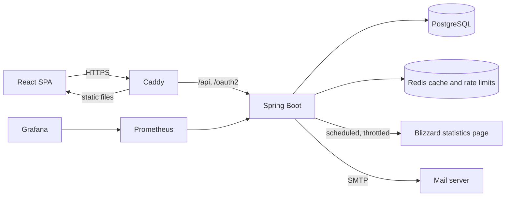

# Overlab

Unofficial fan site with Overwatch 2 hero statistics: win rate, pick rate and ban rate per hero, per map, per rank, region and platform, with history kept as snapshots. Planned extras: perks, hero descriptions, curated counter-picks and synergies, video guides. Not affiliated with Blizzard Entertainment.

## Stack

- Backend: Spring Boot (Java 21, Gradle), PostgreSQL 16, Redis 7
- Frontend: React + TypeScript (Vite)
- Monitoring: Prometheus + Grafana

## Frontend

React 19 and TypeScript with Vite. Plain CSS (dark theme by default, light theme follows the system setting), `react-router-dom`, `axios`. Code lives in `src/features/<domain>/` (`stats`, `heroes`, `maps`, `guides`, `auth`).

| Address | Page |
|---|---|
| `/stats?queue=&tier=&map=&platform=&region=&role=&sort=&direction=` | Hero statistics; filters live in the address, so every view can be shared |
| `/heroes`, `/heroes/:slug` | Heroes; a hero page has map statistics, perks, counters, synergies (with category chips above the hero cards) and guides |
| `/maps`, `/maps/:slug` | Maps; hero statistics with differences from the all-maps values |
| `/perks` | Perks of all heroes on one page, grouped by role, left and right as in the game |
| `/counters` | Counters and synergies of all heroes on one page, with role and name filters and a compact or detailed view |
| `/heroes/:slug/counters` | Redirects to the hero page |
| `/heroes/:slug/perks` | Redirects to `/perks` |
| `/heroes/:slug?queue=` | A hero: rates and history, best and weakest maps (expandable to every map, each links to its map page), abilities, perks, counters, spots; `/maps/:map/:hero` redirects here |
| `/patches` | Redirects to `/changes`; patches are shown as dashed lines on the statistics chart and as views in `/changes` |
| `/changes?view=7d\|30d\|patch:<slug>&queue=` | Which heroes gained or lost win and pick rate between two snapshots |
| `/guides/:id-:slug` | A single spot or setup video (YouTube embed) |
| `/login`, `/register`, `/verify-email`, `/forgot-password`, `/reset-password` | Accounts |
| `/me` | Favorites, notes and default filters |
| `/me/settings` | Change name, password and email, download or delete your data |

The header has a hero search (keyboard friendly) and a compact menu on narrow screens. Auth and admin pages are loaded lazily. `npm run size` (run in CI after `npm run build`) fails when the entry chunk exceeds 125 KB gzip or any other chunk exceeds 30 KB. Component accessibility is checked with `vitest-axe`.

### Admin

`/admin/**` is available to the `ADMIN` role only (the link appears in the header for admins). Anonymous visitors are sent to `/login` and returned afterwards, regular users get the same "Page not found" page as for an unknown address, so the admin area is not revealed. The server checks every request; the frontend only hides what is not allowed. Admin pages are marked `noindex` and disallowed in `robots.txt`.

| Address | Purpose |
|---|---|
| `/admin/heroes` | Edit hero description, hide or show a hero |
| `/admin/abilities` | Abilities per hero: choose the control slot (primary or secondary fire, ability 1 or 2, ultimate, passive); saved at once and written to the audit log |
| `/admin/perks` | Perks per hero: slot (minor or major), position (left or right, as in the game; one perk per slot and position), recommendation, note, icon upload |
| `/admin/relations` | Counters and synergies; duplicates and reverse relations are flagged before saving |
| `/admin/categories` | Hero categories (name, slug, member heroes) and matchups of a hero against a category (strong, weak or works well with, strength, note) |
| `/admin/guides` | Spots and setups: paste a YouTube link (`youtu.be/...`, `watch?v=...`), hero, map, type (setup, position, ultimate spot, tip), side (attack, defense, both), optional ability, start and end time as `1:23`, video preview, publish and order. Shown on the map page grouped by hero and on the hero page grouped by map |
| `/admin/patches`, `/admin/maps` | Patch notes; map mode and image upload |
| `/admin/collector` | Jobs, "Run now" (the run history refreshes while a run is in progress) |
| `/admin/users` | Search users, block and unblock |
| `/admin/audit` | Audit log with filters and "was → became" changes |

Create and edit forms open in a side panel over the table (Esc, the close button or a click outside closes it; unsaved changes ask for confirmation). Forms warn about unsaved changes when you leave the page.

### Images

Images are files in the media directory (`MEDIA_DIRECTORY`, default `./media`, `/app/media` in Docker where it is the `media` volume), split into `heroes/`, `maps/`, `perks/` and `abilities/`. The database stores only the relative path (`maps/busan-3fa9c21e.png`); the API turns it into a URL with `MEDIA_BASE_URL` (default `/media`), so the files can later move to a CDN by changing that one value. The backend serves `/media/**` with a 7 day cache; Caddy proxies it.

- **Role icons:** with the same flag the collector saves the three role icons (SVG, checked for scripts and handlers) as `roles/tank.svg`, `roles/damage.svg` and `roles/support.svg`; the site uses them next to hero names and falls back to its own simple icons when the files are missing.
- **Perk import:** with `COLLECTOR_IMPORT_PERKS=true` the button "Import from Blizzard" on `/admin/perks` reads the perk section of every hero page (`/en-us/heroes/<slug>/`, about 3 minutes with the collector pause) and creates the missing perks with their description, slot, left or right position and icon. New perks start as `OPTIONAL`; recommendations and notes stay yours, and an existing perk keeps its text, slot and icon (only a missing description or icon is filled). The page is HTML, so the parser (`HeroPerkParser`) may need an update when Blizzard changes the markup. Off by default for the same licence reason as portraits.
- **Patch import:** every day at 03:45, before the first collector job, and once on every backend start so a missed run is caught up (`collector.patch-import.cron`, disable with `collector.patch-import.enabled=false`) the collector reads the official patch notes page (`/en-us/news/patch-notes/`) and saves each patch that changes heroes or maps: version is the release date (`2026-10-13`), title is the season or the first section name, notes hold the link to the official notes. Bug-fix-only patches are skipped, existing patches are never changed, and the notes text is not copied. The button "Import from Blizzard" on `/admin/patches` runs it now. Patches show up on the statistics chart as dashed lines. The parser (`PatchNotesParser`) fails loudly when the page markup changes. A new patch released within the last 7 days (`collector.patch-import.recent-days`) also starts a full collection in the background: every collector job with `run-on-patch: true` (the default) runs one after another with trigger `PATCH`, including jobs whose schedule is disabled (console, other regions), so heroes, maps and every configured platform and region get fresh numbers for the new patch. Set `run-on-patch: false` on a job to keep it out of that run; patches imported on a fresh install that are older than the window start nothing.
- **Abilities:** the same import also reads the ability section of every hero page and fills `hero_abilities` (slug, name, description, icon); existing abilities get their name, description and order refreshed and a missing icon filled. Text fields (counter and synergy notes, strengths, weaknesses, hero description) can mention an ability as `[[hero-slug/ability-slug]]` (for example `[[dva/defense-matrix]]`); the site shows it as a chip with the icon and a tooltip with the description, and falls back to a plain readable name when the ability is unknown. Blizzard's page does not say which button an ability uses, so `hero_abilities.control_key` (`PRIMARY_FIRE`, `SECONDARY_FIRE`, `ABILITY_1`, `ABILITY_2`, `ULTIMATE`, `JUMP`, `CROUCH`, `PASSIVE`; default PC keys LMB, RMB, Shift, E, Q, Space, Ctrl; the hero page switch also shows the Xbox, PlayStation and Nintendo Switch defaults) is curated by hand, is never touched by the import, and stays empty when unknown.
- **Maps and perks:** upload in the admin panel (PNG, JPEG or WebP, up to 2 MB; SVG is refused). The file name contains a short hash, so a replaced image is never served stale, and the old file is deleted.
- **Hero portraits:** the collector can download the portraits from the statistics response (256x256 PNG) into `heroes/`. This is off by default (`COLLECTOR_DOWNLOAD_PORTRAITS=false`) because the images are Blizzard's and the licence question is still open (see `.tasks/current/0008-images-and-storage.md`). Without it the site shows the first letter of the hero name.
- The daily backup also archives the media volume (`overlab-media-<timestamp>.tar.gz`).

## Architecture



The collector is the only component that talks to Blizzard. User requests are served from the database and the Redis cache.

## Structure

```
backend/    Spring Boot API and statistics collector
frontend/   React SPA
docker/     Prometheus and Grafana configuration
```

## Running locally

1. Infrastructure:

```bash
cp .env.example .env
```

Fill in `DB_PASSWORD` and `GRAFANA_ADMIN_PASSWORD` in `.env`, then:

```bash
docker compose up -d --build
```

This starts the whole stack in one go: site on http://localhost:5173 (React build served by Caddy, `/api` proxied to the backend), backend, PostgreSQL, Redis, Mailpit (http://localhost:8025), Prometheus (http://localhost:9090) and Grafana (http://localhost:3000). The collector runs only on its schedule, so on a fresh database start the first collection from the admin panel (Collector, "Run" next to `daily-overview`). For hot-reload development start only the infrastructure with `docker compose up -d postgres redis mailpit prometheus grafana` and continue with the steps below.

2. Backend (the `local` profile is the default):

```bash
cd backend && ./gradlew bootRun
```

3. Frontend (Vite proxies `/api` and `/oauth2` to the backend on port 8080):

```bash
cd frontend && npm ci && npm run dev
```

## URLs

- Frontend: http://localhost:5173
- API: http://localhost:8080/api
- Health: http://localhost:8080/actuator/health
- Mailpit (local mail inbox): http://localhost:8025
- Prometheus: http://localhost:9090
- Grafana: http://localhost:3000

## API

The statistics endpoints are public `GET` requests.

| Endpoint | Description |
|---|---|
| `/api/heroes`, `/api/heroes/{slug}` | Heroes |
| `/api/maps`, `/api/maps/{slug}` | Maps |
| `/api/stats` | Statistics table. Parameters: `queue`, `tier`, `map`, `platform`, `region`, `role`, `sort`, `direction`. For a map it also returns deltas against the all-maps numbers |
| `/api/stats/hero/{slug}` | Statistics of one hero across all maps |
| `/api/stats/hero/{slug}/history` | Snapshots of one hero over time. Parameters: `queue`, `tier`, `map`, `platform`, `region`, `from`, `to` (ISO date-time; default is the last 90 days, at most 366 days) |
| `/api/stats/freshness` | When Blizzard's numbers last changed, found by comparing the latest snapshots of one queue, rank, platform and region (`valuesSince` is the first snapshot that already had the current numbers). Parameters: `queue`, `tier`, `platform`, `region` |
| `/api/stats/compare` | Changes between two snapshots, biggest win rate gain first. Use `from` and `to` (the last snapshot at or before each moment) or `patch={slug}` (last snapshot before the release against one a week later) |

Quick Play has no ranks (`tier` is ignored) and no ban rate. Errors use one JSON shape (`ApiError`).

Curated content, also public `GET` requests:

| Endpoint | Description |
|---|---|
| `/api/perks` | Perks of all heroes |
| `/api/heroes/{slug}/perks` | Perks with a recommendation (`RECOMMENDED`, `OPTIONAL`, `AVOID`) |
| `/api/abilities` | Abilities of all heroes |
| `/api/heroes/{slug}/abilities` | Abilities of a hero with description and icon |
| `/api/hero-categories` | Hero categories (for example beam or dive) with their members, and curated hero-versus-category matchups (strong against, struggles against or works well with a category); shown as chips on `/counters`, where heroes covered by a chip of equal or higher strength are not repeated as separate avatars |
| `/api/hero-relations` | Counters, counters against and synergies of all heroes in one response |
| `/api/heroes/{slug}/counters` | Heroes this hero counters and heroes that counter it |
| `/api/heroes/{slug}/synergies` | Heroes that work well together (both directions) |
| `/api/guides?hero=&map=`, `/api/guides/{id}-{slug}` | Published spots and setups (YouTube embeds; `kind`, `side`, `abilitySlug`, `startSeconds`, `endSeconds`) |
| `/api/patches`, `/api/patches/{slug}`, `/api/patches/at?date=` | Patches and the patch active at a date |
| `/api/sitemap.xml` | Sitemap of the public pages (static pages, active heroes, maps); served as `/sitemap.xml` by the edge proxy, which also answers `/robots.txt` with the sitemap link |

Counters, synergies and perks are curated recommendations, not statistics. They are managed through the admin API (`ADMIN` role): `/api/admin/perks`, `/api/admin/hero-relations`, `/api/admin/hero-categories`, `/api/admin/hero-category-relations`, `/api/admin/guides`, `/api/admin/patches`, `PUT /api/admin/heroes/{slug}` and `PUT /api/admin/maps/{slug}` (image upload: `PUT /api/admin/maps/{slug}/image`, `PUT /api/admin/perks/{id}/icon`). Any admin change clears the content caches.

### Limits and caching

Public `GET /api/**` requests are limited per client IP in Redis: 120 per minute in general and 300 per minute for `/api/stats/**` (`app.rate-limit.api-per-minute`, `app.rate-limit.stats-per-minute`); the limit is exceeded with `429` in the `ApiError` format. Sign-in and registration endpoints keep their own stricter limit. Public responses carry `Cache-Control: public, max-age=60, stale-while-revalidate=300` and an `ETag`; errors, `/api/auth/**` and `/api/admin/**` are never cached. In `prod` the client IP is read from `X-Forwarded-For` set by Caddy.

### OpenAPI

Swagger UI is at `/swagger-ui.html` and the OpenAPI document at `/v3/api-docs`; both require an administrator session (sign in through the site first). They are disabled in the `prod` profile. Controllers carry `@Tag` and `@Operation`, and the statistics DTOs carry `@Schema` descriptions (units, meaning of deltas); keep them in sync when changing those endpoints.

### Authentication

Email and password registration plus Google sign-in. Tokens are stored in `httpOnly` cookies (access token 15 minutes, refresh token 14 days, rotated on every refresh).

| Endpoint | Description |
|---|---|
| `POST /api/auth/register` | Create an account and send a verification email |
| `POST /api/auth/verify-email`, `/resend-verification` | Confirm the email address |
| `POST /api/auth/login`, `/refresh`, `/logout` | Sign in, rotate tokens, sign out |
| `GET /api/auth/me` | Current user |
| `POST /api/auth/forgot-password`, `/reset-password` | Password reset by email |
| `GET /oauth2/authorization/google` | Start Google sign-in (needs `GOOGLE_CLIENT_ID` and `GOOGLE_CLIENT_SECRET`) |
| `PUT /api/me/profile` | Change the display name |
| `POST /api/me/password` | Change the password (local accounts; needs the current password) |
| `POST /api/me/email` | Request an email change; the address changes after the confirmation link sent to the new one is opened (`/verify-email`) |
| `GET /api/me/export` | Download the account data (profile, favorites, notes, default filters) as JSON |
| `DELETE /api/me` | Delete the account (local accounts confirm with the password); audit entries about the user are anonymized, the last administrator cannot be deleted |
| `GET /api/me/favorites`, `PUT`/`DELETE /api/me/favorites/heroes/{slug}`, `/maps/{slug}` | Favorite heroes and maps (200 of each at most) |
| `GET /api/me/notes`, `PUT`/`DELETE /api/me/notes/{heroSlug}` | Private notes per hero (2000 characters, 50 notes; saving an empty note deletes it) |
| `GET`/`PUT /api/me/preferences` | Default mode, rank, platform and region for the statistics filters |
| `GET /api/admin/users`, `PUT /api/admin/users/{id}/enabled` | Admin: search users, block or unblock (blocked users are signed out and cannot sign in; an admin cannot block themselves) |

Signing in with Google using an email that already has a password account links the two, so both ways work. If that account's email was not verified yet, its password is removed (use "Forgot your password?" to set a new one).

Password reset for a Google-only account sends an email that explains it signs in with Google instead of staying silent.

Authentication endpoints are rate limited per IP (Redis). `/api/admin/**` requires the `ADMIN` role. To create the first admin, start the backend once with `ADMIN_EMAIL` and `ADMIN_PASSWORD` set. Locally, emails go to Mailpit unless `.env` sets `MAIL_HOST` (and `MAIL_PORT`, `MAIL_USERNAME`, `MAIL_PASSWORD`, `MAIL_SMTP_AUTH=true`, `MAIL_STARTTLS=true`, `EMAIL_FROM`), for example with Brevo: `MAIL_HOST=smtp-relay.brevo.com`, `MAIL_PORT=587`, the SMTP login and key from Brevo, and `EMAIL_FROM` set to a sender verified in Brevo; in `prod` set `JWT_SECRET` (at least 32 characters) and the `MAIL_*` variables.

### Audit log

Every admin change (perks, counters, synergies, guides, patches, hero and map edits) and user events (registration, sign-in, password change) are written to `audit_log` asynchronously, after the transaction commits, so a failed write never breaks the request. Updates store only the changed fields as `{from, to}`. Secrets and request bodies are never stored. Admins read it with `GET /api/admin/audit` (filters: `entityType`, `actorId`, `action`, `from`, `to`, `page`, `size`). User events are deleted after `app.audit.user-event-retention` (default 90 days).

## Statistics collector

The backend collects statistics from Blizzard's public hero statistics page on a schedule and stores a snapshot per filter combination. Jobs are defined in `backend/src/main/resources/collector.yaml`:

- `daily-overview`: all ranks for Competitive and the overview for Quick Play, all maps combined
- `weekly-maps`: every map, every rank for Competitive (about 310 requests, roughly 16 minutes with the 3 s pause), rank `ALL` for Quick Play
- `weekly-console`, `weekly-other-regions`: disabled examples (`enabled: false`) for Console and other regions

The collector retries temporary Blizzard errors, uses connect and read timeouts, and rejects a response that looks wrong (too few heroes, percentages outside 0-100, unknown roles, duplicates) instead of storing it. Every run is recorded in `collector_runs` (status `SUCCESS`, `PARTIAL` or `FAILED`, requests, failures, rows). A job never runs twice at the same time.

Admin endpoints (`ADMIN` role):

| Endpoint | Description |
|---|---|
| `GET /api/admin/collector/jobs` | Configured jobs |
| `POST /api/admin/collector/jobs/{name}/run` | Start a job now (202, 409 if it is already running) |
| `GET /api/admin/collector/runs` | Latest 50 runs |
| `POST /api/admin/collector/perks/import` | Import perks from the Blizzard hero pages in the background (202; 400 while `COLLECTOR_IMPORT_PERKS` is off, 409 if already running) |
| `POST /api/admin/collector/patches/import` | Import new balance patches from the Blizzard patch notes page now, returns `{created}` |

To run one job when the backend starts:

```bash
COLLECTOR_STARTUP_JOB=daily-overview ./gradlew bootRun
```

The game format stored with every snapshot (`FIVE_VS_FIVE` or `SIX_VS_SIX`) is set with `COLLECTOR_GAME_FORMAT` and must be changed by hand when the game switches format. Snapshots older than 180 days are thinned out weekly, keeping the latest snapshot of each week. Responses are cached in Redis and the caches are cleared after every collector run.

**What is stored.** One row per hero for every combination of mode (Quick Play or Competitive), platform, region, rank and map, with win rate, pick rate and ban rate (Competitive only), the capture time, the game format (`COLLECTOR_GAME_FORMAT`) and the source. A snapshot is stored only when the numbers differ from the previous snapshot of the same combination (a hash of every hero's win, pick and ban rate is compared); an unchanged run only moves the combination's `last_checked_at` in the `snapshot_checks` table, which is also where the last Blizzard `ETag` is kept. The next request sends it as `If-None-Match`, and a `304` answer skips parsing and storage altogether. Pages show the check time ("Checked 5 hours ago") and, from `GET /api/stats/freshness`, when Blizzard last changed the numbers; history charts are extended to the last check. Snapshots are kept as they were captured; older than 180 days they are thinned to the latest one per week. **What is not stored:** anything before the first collector run (Blizzard publishes only current values, and the Internet Archive holds too few copies of the data endpoint to import), individual matches, players, and the game format is not detected automatically because the Blizzard response does not contain it.

Every snapshot is checked after validation but is still stored: pick rates that do not add up to about 500 (5v5) or 600 (6v6) are counted in `collector_suspicious_snapshots_total`, win or pick rate jumps of more than 5 and 8 percentage points against the previous snapshot of the same filters in `collector_outliers_total`, and heroes or maps seen for the first time in `collector_new_heroes_total` and `collector_new_maps_total` (each also logged as a warning; new maps need a mode and image in the admin panel). Every snapshot row has a `source` (`COLLECTOR` or `ARCHIVE`); there is no history from before the first collector run.

Metrics (`collector_requests_total`, `collector_rows_saved_total`, `collector_unchanged_snapshots_total`, `collector_job_duration_seconds`, `collector_last_success_timestamp_seconds`, `collector_last_change_timestamp_seconds{queue}`) are exposed to Prometheus, and the Grafana dashboard "Overlab: collector and API" is provisioned from `docker/grafana/dashboards/`.

## Profiles

- `local` (default): defaults for localhost, SQL logging, health details, Prometheus endpoint
- `prod` (`SPRING_PROFILES_ACTIVE=prod`): no defaults for database and Redis, no error or health details

## Deployment

The whole stack (HTTPS proxy with the React build, backend, PostgreSQL, Redis, Prometheus, Grafana, daily database backups) runs from `docker-compose.prod.yml` on a single server. See [docs/DEPLOY.md](docs/DEPLOY.md). In `prod` the metrics endpoint is served on an internal port (9091) and is not published.

## Checks

```bash
cd backend && ./gradlew build
cd frontend && npm run lint && npm run format:check && npm test && npm run build
```

`./gradlew build` runs Checkstyle (no tabs, wildcard imports or code comments) and all tests. Integration tests start their own PostgreSQL and Redis with Testcontainers, so Docker must be running, but `docker compose up` is not needed. They cover the migrations, the statistics queries, the role matrix of every protected endpoint, the sign-in flow and the audit log.

## Branches and CI

- `main`: production
- `develop`: development
- GitHub Actions runs the backend and frontend checks on every push and pull request. Dependabot opens weekly update pull requests; minor and patch updates are merged automatically after CI passes, major updates are merged manually.
