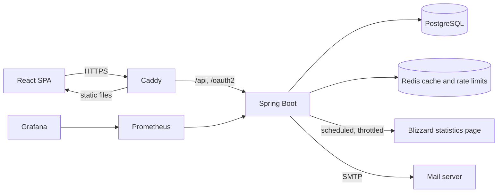

# Architecture and conventions



The collector is the only component that talks to Blizzard. User requests are served from the database and the Redis cache.

## Structure

```
backend/    Spring Boot API and statistics collector
frontend/   React SPA
docker/     Prometheus and Grafana configuration
```

### Backend conventions

- Package by feature under `backend/src/main/java/gg/overlab/backend/`: a domain (`hero`, `stats`, `gamemap`, `guide`, `patch`, `feedback`, `user`, `audit`, `collector`, ...) keeps its entity, repository, service, mapper and controllers together, with request and response records in `dto/` and domain exceptions in `exception/`. Shared code lives in `config/`, `exception/`, `common/` and `media/`; keep `common/` small and put new classes in the domain that owns them.
- Controllers are thin: they validate input, call one service and return a DTO. Business logic and transactions belong in services, and controllers never use repositories. Mappers are explicit classes (no MapStruct), because most DTOs compute fields such as media URLs.
- Errors use one `ApiError` format produced by `ApiErrorHandler`; new exception types are added there. Filters that must answer with an error (for example the rate limiter) hand the exception to the same handler.
- Configuration uses constructor injection only; no code comments except Javadoc on public APIs (Checkstyle enforces it).
- Tests mirror the main packages. Unit tests use Mockito; `integration/` tests start PostgreSQL and Redis with Testcontainers. `architecture/ArchitectureTest` (ArchUnit) guards the layering above and requires the top-level packages to be free of cycles: `config/` and `exception/` are base layers that never depend on a domain, and a domain reaches into `config/` only through small interfaces it implements itself (for example `AdminAccessChecker`, `TokenSubject`, `FeedbackAuthors`). `collector/` is split into `client/` (Blizzard HTTP clients), `parser/`, `imports/` (perks, abilities, patches, maps), `media/` (image downloads) and `snapshot/` (validation and storage of statistics); public and admin endpoints of a domain live in separate `*Controller` and `*AdminController` classes.

## Profiles

- `local` (default): defaults for localhost, SQL logging, health details, Prometheus endpoint; the backend refuses to start with it when `FRONTEND_URL` is an `https://` address, which means `SPRING_PROFILES_ACTIVE=prod` was forgotten
- `prod` (`SPRING_PROFILES_ACTIVE=prod`): no defaults for database and Redis, no error or health details, `/actuator/prometheus` only on the management port `MANAGEMENT_PORT` (default 9091, not published outside the Docker network; Prometheus scrapes it there)

The backend is designed to run as a single instance. The retention jobs (audit log, feedback, collector runs, snapshots, expired tokens), the collector jobs and the patch import take a PostgreSQL advisory lock by name (`ScheduledJobLock`, held on a separate connection for the whole run), so an old and a new instance that overlap during a deploy do not run the same job twice; a collector run that loses the lock is recorded as failed with the summary "Another instance is running this job". The startup cleanup of interrupted runs and runs started inline have no distributed lock.

## Testing

`./gradlew build` runs Checkstyle (no tabs, wildcard imports or code comments) and all tests. Integration tests start their own PostgreSQL and Redis with Testcontainers, so Docker must be running, but `docker compose up` is not needed. They cover the migrations, the statistics queries, the role matrix of every protected endpoint, the sign-in flow and the audit log. `./gradlew test` also writes a JaCoCo coverage report to `backend/build/reports/jacoco/test/html/index.html` (XML next to it); `./gradlew check` fails when line coverage drops below 65%.
